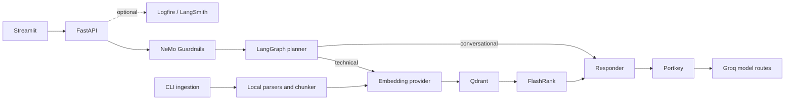

# Architecture

## Runtime components

## Query path

1. FastAPI validates the request, assigns a request ID, and creates a UUID conversation ID if `thread_id` was omitted.
2. NeMo Guardrails evaluates the input. A matched canned rail response returns without invoking the graph.
3. LangGraph plans from the conversation checkpoint. Technical requests use the selected embedding provider, query Qdrant, rerank up to five passages, and call the responder. Conversational requests skip retrieval.
4. The responder calls Portkey, which is configured with a primary and fallback Groq route.
5. The API returns a typed JSON response. Exceptions produce a generic 502 response; the server log records the request ID and exception type.

## Ingestion path

`python -m app.ingestion.processor <directory>` scans files, parses supported formats, chunks text with a character ceiling, saves derived chunk JSON under `processed_data/`, embeds it, and upserts vectors to Qdrant. The configured embedding provider must match the collection dimension. `--wipe` deletes that collection before recreating it.

## State and boundaries

- `MemorySaver` keeps conversation state in process memory. It is not shared across workers or replicas, has no expiry, and is cleared on process restart.
- Qdrant and model gateways are external dependencies. The liveness endpoint checks process responsiveness; readiness checks required configuration only.
- The Streamlit frontend and evaluation UI are separate processes. The Docker image contains only the API runtime.
- No authentication, authorization, multi-tenancy, or distributed state is implemented.
- Optional tracing can export request and model data to configured observability services; enable it only after reviewing data handling.

## Key modules

| Module | Responsibility |
|---|---|
| `app/main.py` | FastAPI lifecycle, request validation, health and query routes |
| `app/agents/graph.py` | LangGraph nodes, routing, and in-memory checkpoint |
| `app/agents/nodes/` | Planner, retrieval, and response generation |
| `app/gateway/client.py` | Portkey client and model route configuration |
| `app/guardrails/` | NeMo rails and response indicators |
| `app/ingestion/` | File parsing, chunking, and Qdrant ingestion |
| `app/services/retrieval/` | Embeddings, Qdrant queries, and reranking |
| `evals/` | Golden datasets, live API calls, and metric UI |
| `ui/` | Streamlit chat clients |
