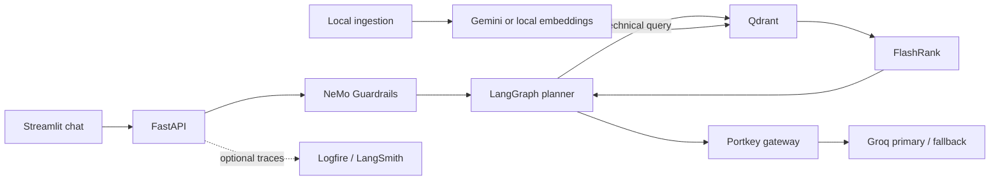

# Enterprise Agentic RAG

A reference implementation of a document question-answering service using FastAPI, LangGraph, NeMo Guardrails, Portkey, Groq, Gemini embeddings, Qdrant, and FlashRank. It includes a Streamlit chat UI and an evaluation UI. This repository is an engineering example; it has not been independently assessed or certified for production use.

## Problem statement

Teams need a way to retrieve relevant passages from a document collection and use them as context for generated answers. This project demonstrates a small local ingestion flow and a service-backed retrieval flow, with a simple guardrails gate and evaluation tooling.

## Key capabilities

- Paragraph-aware chunking and local PDF, HTML, text, DOCX, and PPTX parsing.
- Gemini or local sentence-transformer embeddings, selected explicitly per collection.
- Qdrant vector retrieval and FlashRank reranking.
- LangGraph planner, retriever, and responder nodes with in-process conversation checkpoints.
- FastAPI query and health endpoints; Streamlit chat and evaluation interfaces.
- Optional Logfire and LangSmith tracing.

Guardrails and retrieval quality depend on model, data, and configuration. The application has no authentication or authorization layer.

## Architecture



## Technology stack

| Area | Components |
|---|---|
| API and orchestration | FastAPI, Pydantic, LangGraph |
| Safety and generation | NeMo Guardrails, Portkey, Groq |
| Retrieval | Qdrant, Gemini or sentence-transformer embeddings, FlashRank |
| UI and evaluation | Streamlit, RAGAS |
| Observability | Optional Logfire and LangSmith |
| Runtime | Python 3.11, Docker |

## Project structure

```text
app/       API, agent graph, gateway, guardrails, ingestion and retrieval
ui/        Streamlit chat interfaces
evals/     Golden datasets, live pipeline and evaluation UI
DATA/noisy_data/  Synthetic noise corpus for parser and retrieval demos
DATA/true_data/   Tracked corpus; rights must be confirmed before public release
processed_data/   Derived chunks; currently tracked, with future outputs ignored
tests/     Mocked unit and API tests
docs/      Setup, API, operations, evaluation and deployment guides
```

## Prerequisites

- Python 3.11 for local development; Docker for container builds.
- A Qdrant endpoint and API key.
- Portkey and Groq credentials for answer generation and guardrails.
- Gemini API key when using `EMBEDDING_PROVIDER=gemini` (the default).
- Local embedding dependencies and model download access when using `EMBEDDING_PROVIDER=local`.

## Environment setup

Copy `.env.example` to `.env` and set the required values. `.env` is ignored by Git; never commit credentials. Required backend settings are `QDRANT_CLUSTER_ENDPOINT`, `PORTKEY_API_KEY`, `GROQ_API_KEY`, and, with the default embedding provider, `GEMINI_API_KEY`. Configure the Portkey aliases `rag` and `brag` with the primary and fallback Groq routes. `LOGFIRE_TOKEN` and LangSmith variables are optional. Set `LANGSMITH_TRACING=false` unless tracing is intentionally enabled.

## Installation

```powershell
python -m venv .venv
.\.venv\Scripts\Activate.ps1
python -m pip install --upgrade pip
python -m pip install -r requirements.txt
```

## Document ingestion

Ingest the supported documents in `DATA/` and index them in the configured Qdrant collection:

```powershell
python -m app.ingestion.processor DATA/noisy_data noisy
```

Use `--wipe` only when you intend to delete and recreate the configured collection:

```powershell
python -m app.ingestion.processor DATA/noisy_data noisy --wipe
```

Ingestion writes parsed chunks to `processed_data/` and creates Qdrant points. The local embedding model must match the collection’s embedding provider and vector dimension. See [data handling](docs/OPERATIONS.md#data-and-retention).

## Running the backend

```powershell
uvicorn app.main:app --host 127.0.0.1 --port 8000
```

The service validates required settings at startup. Liveness is at `/health/live`; configuration readiness is at `/health/ready`.

## Running the frontend

In a second terminal:

```powershell
$env:BACKEND_URL = "http://127.0.0.1:8000"
streamlit run ui/app.py
```

The Streamlit session ID is used as the conversation ID. The backend’s memory is process-local and is lost on restart.

## API examples

```powershell
Invoke-RestMethod -Method Post -Uri http://127.0.0.1:8000/query `
  -ContentType 'application/json' `
  -Body '{"q":"How does the documented autoscaling flow work?"}'
```

`q` must contain 1–8,000 characters. An optional `thread_id` (up to 128 characters) continues an existing conversation; callers should keep it private and unique. The response includes `question`, `answer`, `thought_process`, `status`, `sources`, and a request ID. See [API reference](docs/API.md).

## Docker setup

Build and run the backend image (provide secrets through your deployment environment, not image build arguments):

```powershell
docker build -t enterprise-agentic-rag .
docker run --rm -p 8080:8080 --env-file .env enterprise-agentic-rag
```

The image runs as a non-root user and exposes a liveness health check. It contains the API only; the Streamlit UI and ingestion/evaluation commands run locally. See [deployment guide](docs/DEPLOYMENT.md).

## Evaluation instructions

Run the backend, then launch:

```powershell
streamlit run evals/app.py
```

The live pipeline contacts the configured API; LLM-based RAGAS metrics can incur provider costs. Do not interpret the checked-in golden data as measured performance. See [evaluation guide](docs/EVALUATION.md).

## Testing

Install development dependencies with `requirements.txt`, then run:

```powershell
python -m pytest
ruff check app evals ui tests
ruff format --check app evals ui tests
```

Tests mock external services and do not require paid API credentials. CI also audits the production dependency manifest and builds the Docker image.

## Security considerations

- This sample has no authentication, authorization, or tenant isolation. Do not expose it to untrusted networks without adding and reviewing an access-control design.
- Treat prompts, source documents, model traffic, and optional traces as potentially sensitive. Review provider data handling and disable tracing where inappropriate.
- Keep `.env` and credentials out of Git; rotate any credential that was accidentally exposed.
- The guardrails are a model-assisted filter, not a security boundary.
- Review the sample corpus’ redistribution rights before publishing or redistributing it. See [SECURITY.md](SECURITY.md).
- No project license has been selected pending source and data rights review; see [LICENSING.md](LICENSING.md).

## Limitations

- Conversation state is in process memory, has no expiry policy, and is lost at restart.
- Qdrant and model providers must be provisioned separately.
- The API readiness endpoint validates configuration, not provider availability.
- Chunking uses character counts and does not preserve page-level citations.
- The checked-in sample corpus may include works without confirmed redistribution rights.

## Roadmap

- Add a rights-reviewed, redistributable demonstration corpus.
- Improve page/source attribution and ingestion reporting.
- Add provider health checks and bounded conversation retention.
- Extend mocked tests and document measured evaluation runs when executed.

## Contributing

See [CONTRIBUTING.md](CONTRIBUTING.md) for setup, checks, and pull request guidance.
